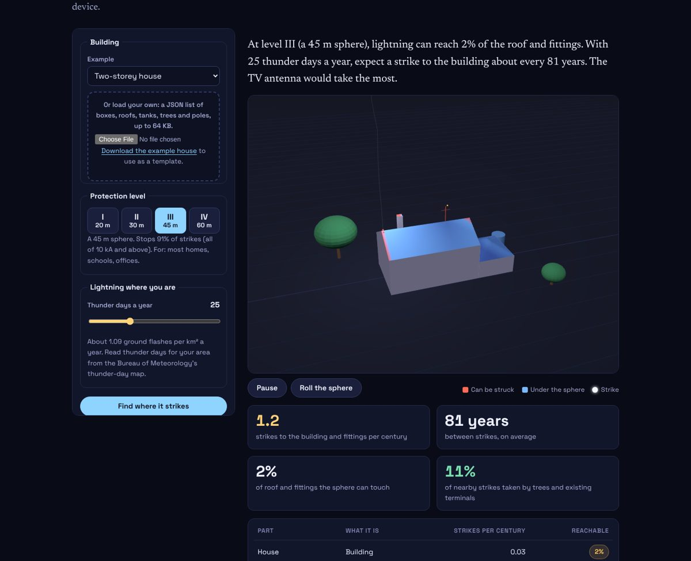
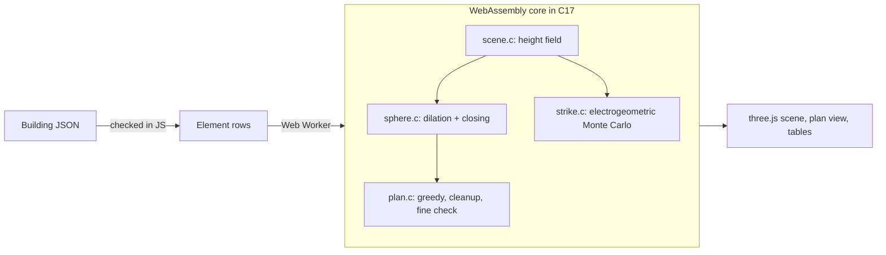
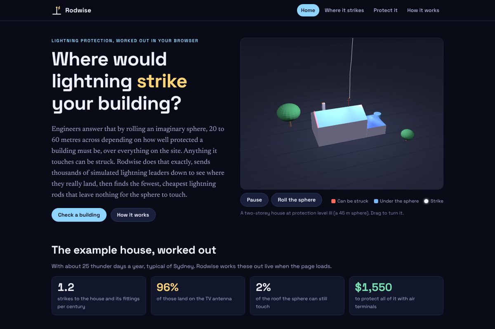
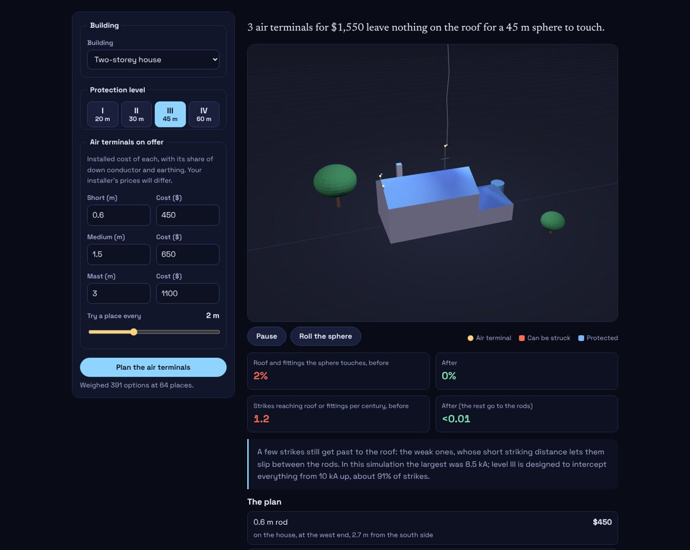
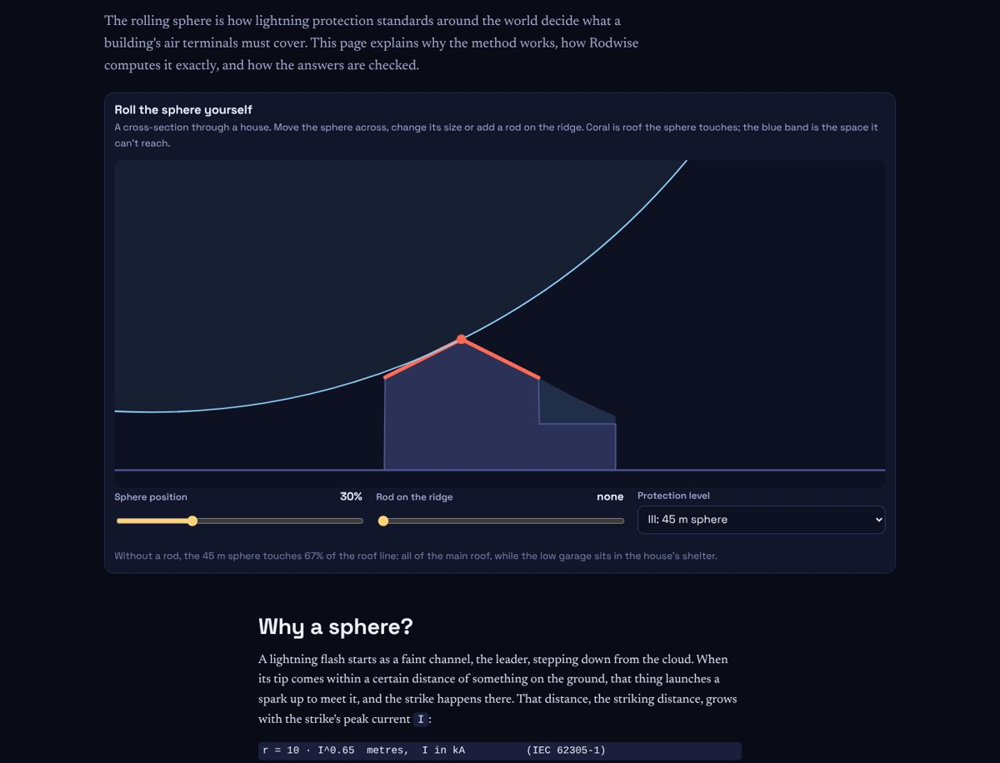

# Rodwise

**Shows where lightning would strike a building, and plans the cheapest lightning rods to protect it.**

[](https://github.com/reihooneh/rodwise/actions/workflows/ci.yml)


**Live demo: [reihooneh.github.io/rodwise](https://reihooneh.github.io/rodwise/)**



## Why I built this

Lightning protection standards (AS/NZS 1768 in Australia, IEC 62305 internationally) decide what a
building's air terminals must cover with a thought experiment. You roll an imaginary sphere, 20 to
60 m in radius depending on the protection level, over everything on the site, and anything it
touches can be struck. Designers still do this with sketches, or with expensive CAD plug-ins. I
wanted to compute it exactly, see *why* it works by simulating the lightning it comes from, and let
anyone see which part of their own house or school would take a strike.

Two findings from the examples surprised me. On an ordinary two-storey house, the TV antenna takes
96% of the strikes: it already acts as a lightning rod, just one nobody bonded to earth. And a
steep church spire can't be kept away from a 20 m sphere with short rods at all, which is exactly
why the standard asks for conductors running over surfaces like that.

## Features

- **Exact rolling sphere.** The building is turned into a height field (half-metre cells) and the
  rolling sphere becomes a grey-scale morphological closing with a ball. That gives, for every cell,
  whether the sphere touches it and how deep under the sphere it sits.
- **Lightning simulation.** The electrogeometric model behind the sphere: 60,000 leaders, each with
  a peak current from a distribution fitted to IEC 62305-1's four interception rates, striking the
  first thing within 10 I^0.65 m. The result is strikes per century for every part of the building.
- **Air terminal planner.** A greedy search that exploits the fact that a rod can only ever protect
  *more*. It then drops redundant rods, shortens what it can, checks the plan on a finer grid, and
  tops it up if needed.
- **Side-flash warnings** for walls taller than the sphere radius.
- **Four pages:** a 3D home page, *Where it strikes*, *Protect it*, and an interactive explainer
  where you roll a sphere over a cross-section yourself.
- **Your own building.** A small JSON format with boxes, gable and hip roofs, tanks, trees, poles
  and rods. It is checked in the page and again in C, and never leaves the device.

## How it works



| | |
|---|---|
|  |  |
|  |  |

For the full story, see [HOW-IT-WORKS.md](HOW-IT-WORKS.md).

## Stack

- **Core:** C17, freestanding (no C library: its own `exp`, `log`, `sin`, `cos` and normal CDF,
  checked against libm). Compiled with clang to a 23 KB WebAssembly module with fixed memory.
- **Site:** plain ES modules, three.js 0.170 and two fonts, all self-hosted. The model runs in a Web
  Worker.
- **Tests:**
  - native C under AddressSanitizer and UBSan;
  - Node tests of the WebAssembly interface;
  - Playwright browser tests at three screen sizes.

## Run it

```sh
npm ci              # three.js, fonts, Playwright (pinned)
npm run build       # clang -> site/assets/rodwise.wasm, then the pages
npm run serve       # http://127.0.0.1:4173/
```

You need clang with the wasm32 target (`apt install clang lld`) and Node 22.

## Tests

```sh
make test-core      # 98 checks in C, with sanitizers
make lint           # -Wall -Wextra -Wconversion ... -Werror, and clang-tidy
npm test            # WebAssembly interface + browser tests (phone, tablet, desktop)
```

What the C tests check:

- **The maths** against the C library, to 1e-12.
- **The protection levels.** The striking distance of each level's minimum current matches its
  sphere radius, and the fitted current distribution gives 99, 97, 91 and 84%.
- **A rod on a flat roof** protects exactly the circle of radius √(L(2R − L)), at three sphere
  sizes.
- **The sag between two long walls** is h + √(R² − d²) − R. Two masts would be wrong: the sphere
  comes in between them from the side.
- **A witness for every touched cell.** For each cell the code says is touched, a clean sphere
  really touches it.
- **Monotonicity.** A rod never exposes anything.
- **The Monte Carlo** matches the exact collection-area integral for a lone mast, within 2%.
- **The planner** leaves nothing exposed at every level and keeps no unnecessary rod. On the
  largest site allowed, its work limit stops it.
- **Hostile elements** (NaN, infinity, out of range, wrong shapes, too many) are refused.

The browser tests fail on:

- overlapping text or controls, at 390, 820 and 1440 px;
- sideways scrolling, and chart parts outside their chart;
- console errors;
- any request leaving the site, and pages missing the CSP.

They also load hostile building files, and run the pages' main features.

## Security

- **Untrusted input.** A building file is untrusted. It's capped at 64 KB, parsed with
  `JSON.parse`, and checked field by field: only known shapes and kinds, and finite numbers within
  physical ranges. Names are limited to letters, digits and simple punctuation. The C core checks
  every number again at the WebAssembly boundary.
- **No markup from files.** Nothing from a file is ever inserted as HTML: the pages use
  `textContent` and DOM calls only.
- **Strict CSP.** `default-src 'none'`, with scripts only from the site and no inline code. There
  are no third-party requests: everything is self-hosted from pinned npm versions.
- **Bounded work.** At most 80 elements, a 320 × 320 grid, 400,000 leaders, 400 rod candidates and
  40 rods. The planner also has a work limit: on the largest site allowed it stops after a few
  seconds and says so. WebAssembly memory is fixed at 32 MB and never grows. The model runs in a Worker, so the
  page stays responsive.
- **Known limits.** Rodwise models simplified shapes on flat ground, with vertical leaders. It is a
  tool for understanding protection, not a design: a real system must be designed and installed to
  AS/NZS 1768 or IEC 62305 by a qualified professional.

See [SECURITY.md](SECURITY.md) for the threat model and how to report a problem.

## Roadmap

- Sloped ground and imported building outlines (GeoJSON footprints with heights).
- Meshed conductors and catenary wires as air terminations, not just rods.
- The risk assessment of AS/NZS 1768 (loss of life, service, cultural heritage) on top of the strike
  rates.
- An exact optimiser (integer programming) to measure how far from optimal the greedy plan is.

## License

MIT. three.js (MIT), Space Grotesk and Newsreader (SIL Open Font License) are self-hosted with
their licences.
